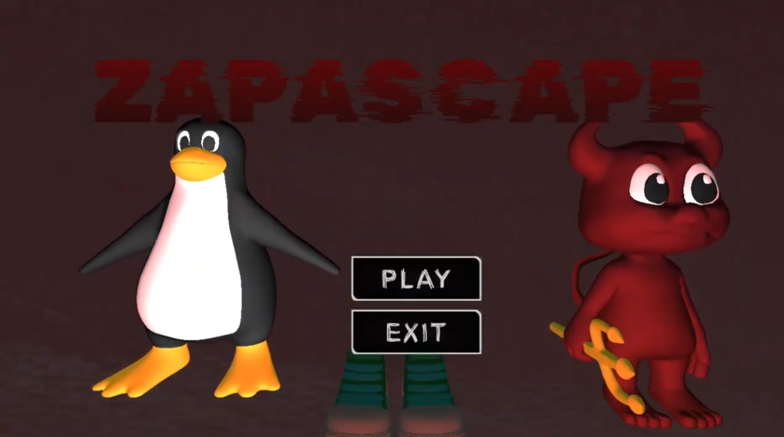
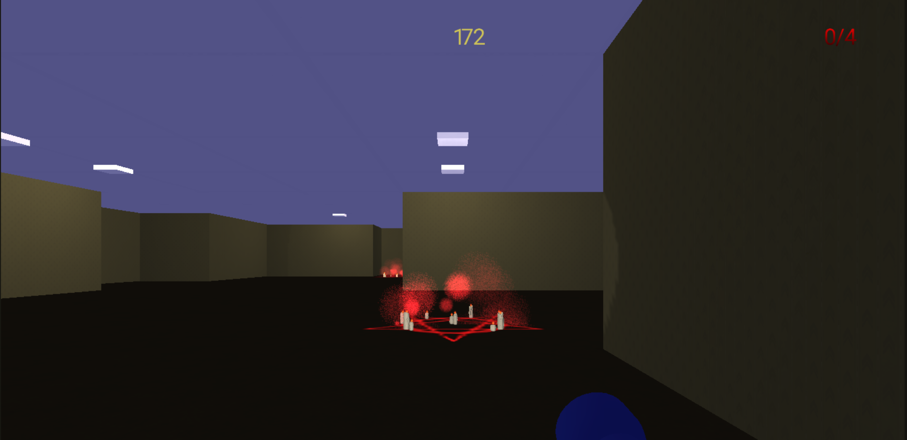
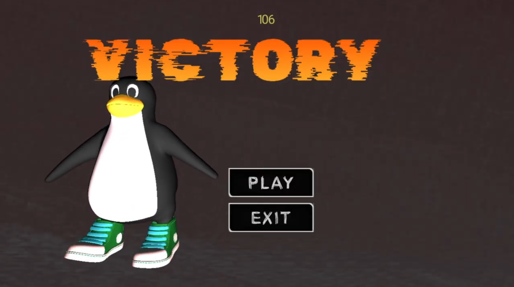
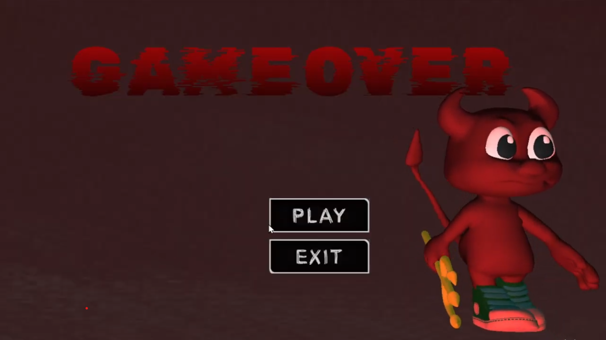

# ZAPASCAPE

**Picante Medio**

**2025–2026**

  

---

  

## ÍNDICE

  

1. [Resumen](#1-resumen)

	1.1. [Descripción](#11-descripción)

	1.2. [Género](#12-género)

	1.3. [Público objetivo](#13-público-objetivo)

  
2. [Historia y contexto del juego](#2-historia-y-contexto-del-juego)

3. [Gameplay](#3-gameplay)

	3.1. [Objetivo del juego](#31-objetivo-del-juego)

	3.2. [Flujo del juego](#32-flujo-del-juego)

  

4. [Mecánicas](#4-mecánicas)

	4.1. [Movimiento del jugador](#41-movimiento-del-jugador)

	4.2. [Comportamiento de enemigos](#42-comportamiento-de-enemigos)

	4.3. [Objetos del mapa](#43-objetos-del-mapa)
  

5. [Estética](#5-estética)

	5.1. [Ambientación](#51-ambientación)

	5.2. [Arte gráfico](#52-arte-gráfico)

	5.3. [Audio](#53-audio)

  

6. [Interfaces](#6-interfaces)

	6.1. [HUD](#61-hud)

	6.2. [Menús](#62-menús)

  

7. [Referencias](#7-referencias)

  

---

  

## 1. Resumen

  

### 1.1. Descripción

Zapascape es un juego de terror en 3D y primera persona en el que el jugador se queda encerrado en un laberinto con temática backrooms. Su misión es encontrar caminos para desactivar los rituales e intentar llegar a la puerta de salida, mientras esquiva a los demonios que le persigue. Estos reacccionan al movimiento del jugador: cuando el jugador se detiene, ellos también.

  

### 1.2. Género

Terror, puzzle, 3D, primera persona.

  

### 1.3. Público objetivo

Jugadores jóvenes y adultos (12+ / 16+).

  

---

  

## 2. Historia y contexto del juego

Tras robar **los zapatos de *Beastie***, un demonio, este se enfada. Como castigo, el jugador queda atrapado en la casa del demonio, transformada en un **laberinto**. Por los pasillos, los demonios invocados por *Beastie* persiguen al jugador, acercándose por cada paso que da. La única forma de escapar de ese lugar, es **desactivar los rituales** que se encuentran por el laberinto, lo que hará aparecer la **puerta de salida**. Para lograrlo, el jugador deberá esquivar al demonio y explorar el laberinto en busca de los rituales que mantienen la maldición.
  

---

  

## 3. Gameplay

  

### 3.1. Objetivo del juego

El objetivo principal del juego es **explorar el entorno para localizar y desactivar los rituales encantados**, evitando en todo momento al monstruo que se encuentra en el nivel. Esta criatura **avanza de forma progresiva en función del avance del jugador**, aumentando la presión constante durante la exploración.

Si el jugador se encuentra con el monstruo, deberá **mantenerse inmóvil o reaccionar con rapidez para elegir una ruta de escape**, ya que cualquier error o indecisión provocará que la criatura se dirija directamente hacia él.

  

### 3.2. Flujo del juego

Al iniciar el juego, el jugador es dirigido al **menú principal**, donde se presentan dos opciones: **Start** (comenzar partida) y **Exit** (salir de la aplicación). Al seleccionar **Start**, se iniciará el juego, creando un mapa generado procedimentalmente.

Una vez generado el nivel, el jugador entra en el **bucle principal de la partida**. El personaje aparece en un punto concreto del laberinto y debe **explorar el escenario, aprender las rutas y planificar sus acciones** mientras se desplaza por el mapa. Al **desactivar todos los rituales**, se desbloquea la **puerta de salida**; al interacturar con ella, el jugador completa el nivel, se accede al **menú de victoria**. Si el jugador **no logra desactivar todos los rituales y abrir la puerta en el tiempo dado**, el juego terminará y el jugador irá al **menú de derrota**.

Si el jugador es alcanzado por el monstruo, pierde la partida inmediatamente y se muestra el **menú de derrota**.

  

---

  

## 4. Mecánicas

  

### 4.1. Movimiento del jugador

El jugador puede moverse libremente en todas las direcciones utilizando las teclas **W, A, S y D**. La **rotación de la cámara** se controla mediante el **botón derecho del ratón**, afectando únicamente al eje horizontal para proporcionar una navegación fluida y precisa por el entorno.

Además, la tecla **E** permite interactuar con distintos elementos del escenario, como rituales y puerta final. Por otro lado, la tecla **F** se utiliza para colocar marcas en el suelo, facilitando la orientación y la exploración del mapa.

  

### 4.2. Comportamiento de enemigos

El **enemigo** utiliza una lógica de **comportamiento reactiva** al movimiento del jugador. Su actualización de posición depende de las acciones del jugador, creando la sensación de que el mundo responde directamente a las decisiones del jugador.

Mientras el jugador se desplace, el enemigo ejecutará su lógica, que consiste en:
  
- **Patrulla** el entorno de manera libre hasta que el jugador entre en su radio de influencia. En ese estado, no se parará cuando el jugador se pare.

- En el momento que el jugador es detectado, el enemigo entra en estado de **persecución y avanza hacia** el jugador.

Si el **jugador permanece parado** y el enemigo está en el estado de persecución, este no reaccionará. Sin embargo, tras superar un periodo de tiempo determinado, los enemigos comenzarán a avanzar igualmente, para ejercer una presión sobre el jugador.

  

### 4.3. Objetos del mapa

-  **Marcas en el suelo:** el jugador dispone de un número limitado de marcas con forma de huella de pingüino, que puede colocar en el laberinto para **recordar las rutas ya recorridas**. Las marcas pueden colocarse libremente, pero al superar el límite máximo permitido, la marca más antigua se elimina automáticamente.

- **Rituales satánicos y puerta final:** son objetos **interactuables** ubicados en puntos predefinidos del laberinto. Para poder interaccionar con la puerta, necesitas obligatoriamente visitar todos los rituales, sin importar el orden en el que hayan sido visitados.

---

## 5. Estética

  

### 5.1. Ambientación

El juego se desarrolla en un laberinto inspirado en la estética **Backrooms**. Los espacios están formados por pasillos amplios y salas repetitivas, con una **arquitectura monótona**, diseñada para que el jugador pierda rápidamente la noción de ubicación y orientación.

La visibilidad es limitada, el jugador dispondrá de una **linterna** y solo podrá ver aquello que el haz de luz ilumine directamente.
  
En el laberinto existe **una puerta claramente distintiva**, visualmente llamativa y reconocible como una posible salida. Los rituales satánicos se destacan visualmente por su color rojo intenso, contrastando con la oscuridad del entorno. De cada rito emanan partículas rojas de forma constante.

### 5.2. Arte gráfico

  

### 5.3. Audio

La ambientación sonora es **minimalista** y **opresiva**, con silencios prolongados, sonidos de pasos de los enemigos y la latidos del corazón del jugador.

---

## 6. Interfaces

  

### 6.1. HUD

Durante el juego, en la pantalla aparecerá datos que informarán al jugador sobre su estado actual:

-   **Temporizador**: muestra el tiempo restante en formato segundos.
    

-   **Contador de rituales**: muestra cuántos rituales han sido desactivados y cuantos faltan para desbloquear la puerta de salida.
    

Ambos elementos del HUD están integrados de forma discreta en la pantalla.

### 6.2. Menús

El juego contará con varios **menús** funcionales que permiten al jugador navegar entre distintas secciones y estados del juego:

-   **Menú de principal**: es lo primero que aparece al entrar en la aplicación. Tendrá dos botones: uno para empezar el juego y otro para cerrar la aplicación.  

-   **Menú de Victoria**: aparece cuando el jugador llega a la puerta de salida. El jugador podrá elegir entre volver a jugar, que generará otro mapa, o salir del juego.
    

-   **Menú de Derrota:** aparece cuando el jugador es alcanzado por un enemigo. Ofrece opciones para jugar otra vez o salir del juego.
    

---

  

## 7. Referencias

El juego toma referencias de títulos y conceptos que combinan la explotación con la tensión constante por la persecución constante de los enemigos. En las principales referencias se encuentran ***Beastie*** de FreeBSD, **Hugo**, nuestro compañero de clase, y **escondite inglés.**

En cuanto a juegos ya existentes, el proyecto se inspira en juegos de horror y supervivencia como ***R.E.P.O, Granny***, ***Escape the Backrooms***, ***Phasmofobia***, ***Dark deception*** y ***Lethal Company***. De estos títulos se toman elementos como la **ambientación** y la **exploración** de ambientes cerrados con enemigos persistentes con miedo psicológico combinado con **jumpscares**.
